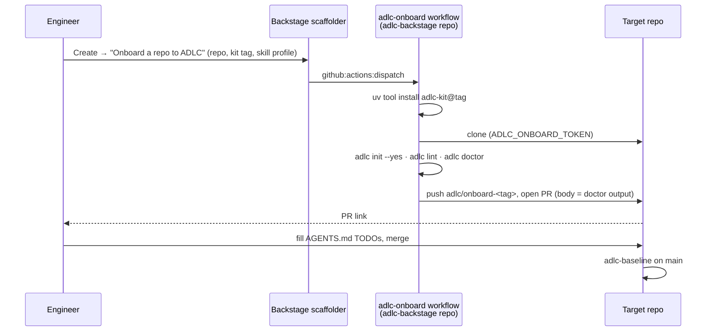

# Onboard from Backstage

The **Onboard a repo to ADLC** template does steps 0, 1 and 3 of the adoption guide for you
and opens the pull request. You still do step 2: fill the prose in `AGENTS.md`.

1. Backstage → Create → *Onboard a repo to ADLC*.
2. Pick the repository. Leave the kit version at the default unless the platform team told
   you otherwise. Leave the skill profile on `lean`.
3. The template dispatches the `adlc-onboard` workflow in `hpreowned/adlc-backstage`. In
   about a minute it pushes a branch `adlc/onboard-<kit-ref>` to your repo and opens a PR whose
   body is the `adlc doctor` output.
4. On that branch, replace every `TODO` in `AGENTS.md` with one line each: build, test, run,
   lint, conventions, what not to touch, where ADRs live. Backticked paths must exist; the
   `adlc-contract-lint` check on the PR fails otherwise.
5. Merge. The `adlc-baseline` workflow builds and commits the graph on `main`.

What the PR contains is exactly what `adlc init` writes: `AGENTS.md` with the kit-owned block,
`.mcp.json`, `.serena/`, the lean graphify skill, `.graphifyrc`, `renovate.json`,
`.github/workflows/adlc.yml` and a `.gitignore` snippet. Polyglot repos also get a per-service
`AGENTS.md`, `.mcp.json` and `.serena/`.

If the workflow fails before the PR exists, the run log is linked from the template output.
The usual cause is the onboarding token lacking access to the target repo; see
[Onboarding workflow and token](../operate/onboard-workflow.md).
