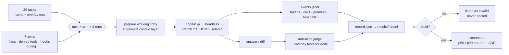

# Method

How a number in the ADR was produced, so you can decide how much to trust it.

**Repos.** Four synthetic repos built to look like one company's estate: `kestrel-services`
(Java booking, Python gateway, C# pricing), `kestrel-web` (TypeScript), `kestrel-ops`,
`kestrel-notify` (Python). Real build and test suites in each, so edit tasks can be judged by
running the tests.

**Tasks.** 29, in three tiers: Tier 1 single-repo questions and small edits, Tier 2 typed-code
edits in Java and C#, Tier 3 cross-repo and archaeology questions that need the federated
graph. Each task has a rubric and, for edits, an overlay test.

**Arms.** `baseline` (Copilot CLI with grep and file reads only), `graphify` (vendor skill),
`graphify-lean` (kit skill, 2 KB), `graphify-guard` (hook denies text search), `graphify-federated`,
`serena` (offered), `serena-forced` (text search denied, symbol tools only). An arm is a
directory of flags, denied tools, hooks and routing text; the harness prepares a working copy
per run.

**Runs.** Three per task per arm, on Copilot CLI 1.0.105 headless with model `auto`; the
resolved model is recorded per run. Prompt tokens = input + cache read + cache write. Wall is
end to end. Premium requests are read from the session events.

**Judging.** A Copilot judge that never sees the arm name scores answers against the rubric;
edits must also pass the overlay test. A human spot-check file is generated; at the pinned
pilot ref it has not yet been reviewed by a human.

**Validity.** A run with a session error, or a non-zero exit and no answer, is invalid: listed
in the scorecard, never pooled. Runs where a context layer was configured but demonstrably not
loaded were invalidated after the fact with the reason attached. Quarantined raw runs keep a
suffix saying why.

**Reproducing.** `make bootstrap` on a Mac, then `make all`. Every number in the report is
produced by one `make` or `adlc` target. Raw runs (events, scrubbed transcripts, judge output)
ship as a release asset on the pilot repo.
