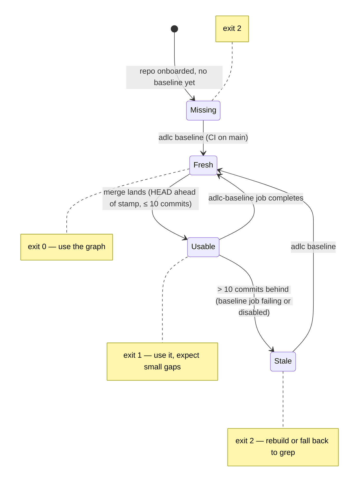

# Freshness

The graph is a committed artifact stamped with the commit it was built from. `adlc stale`
compares that stamp to `HEAD`.

| exit | meaning | agent behaviour |
|---|---|---|
| 0 | fresh: stamp == HEAD | use the graph |
| 1 | usable: HEAD is ≤ 10 commits ahead of the stamp | use the graph, expect small gaps |
| 2 | stale or missing: > 10 commits behind, or never built | rebuild first (`adlc baseline`, or `--incremental` on a branch) or fall back to grep |

The threshold is 10 commits and lives in the kit. The routing section tells the agent to run
`adlc stale` before structural queries, so staleness is a known state, not a silent one.

**Who rebuilds.** CI on merge to `main`. Between the merge and the end of that job the graph is
at most one PR behind. On a long-lived feature branch an engineer or the agent can run
`adlc baseline --incremental` locally for structural questions and must not commit the result.

**Drift.** The nightly `adlc-drift` workflow runs `adlc stale --all` across levels; a repo
whose baseline job failed shows up here the next morning rather than the next time someone
asks the graph a question.
