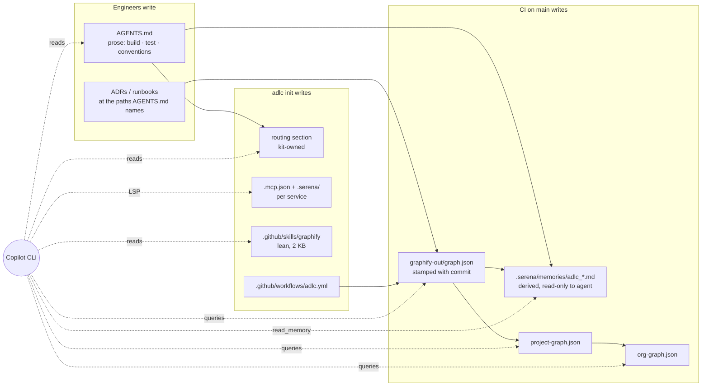

# Where knowledge lives

Everything is in git, in the repo it describes. Nothing lives in `~/.copilot` or on a laptop.

| layer | file | written by | holds |
|---|---|---|---|
| contract | `AGENTS.md` (+ one per service in polyglot repos) | engineers, by hand | build, test, lint, run commands; conventions; what not to touch; where ADRs and runbooks live |
| routing | kit-owned section inside `AGENTS.md` | `adlc init` | which tool for which question: graph, grep, Serena ([Context routing](routing.md)) |
| structural graph | `graphify-out/graph.json`, `GRAPH_REPORT.md` | CI on merge to `main` | who calls what, communities, docs and ADRs as nodes, stamped with the commit |
| derived memories | `.serena/memories/adlc_contract.md`, `adlc_graph_summary.md` | `adlc baseline` | the contract and graph summary, readable by the agent through Serena, not writable |
| per-service Serena | `<service>/.mcp.json`, `<service>/.serena/` | `adlc init` | one language-server project per service; Copilot CLI loads `.mcp.json` from the working directory only |
| project graph | `project-graph.json` in the project repo | `adlc federate` | which consumer breaks if this changes |
| org graph | `org-graph.json` in the org's `.github-private` | `adlc federate --level org` | which team or project is affected |

## What is deliberately not captured

- Decisions made in PR comments or chat. The intended habit is an ADR file under the path
  `AGENTS.md` names; the graph picks it up as a node on the next merge.
- Anything the agent "learned" during a session. Memories are read-only to the agent by
  allowlist, so no agent teaches itself something a human did not review.
- Semantic (docs) graph layers built with an LLM. `GRAPHIFY_BACKEND=none` everywhere headless.
  A docs-heavy repo can run `/graphify .` once inside an interactive Copilot session; `adlc
  baseline` keeps that layer and only re-stamps.

## Known gap

Memories in the repo root are not visible to a per-service Serena project. Per-service
derived memories are on the kit's follow-up list.
