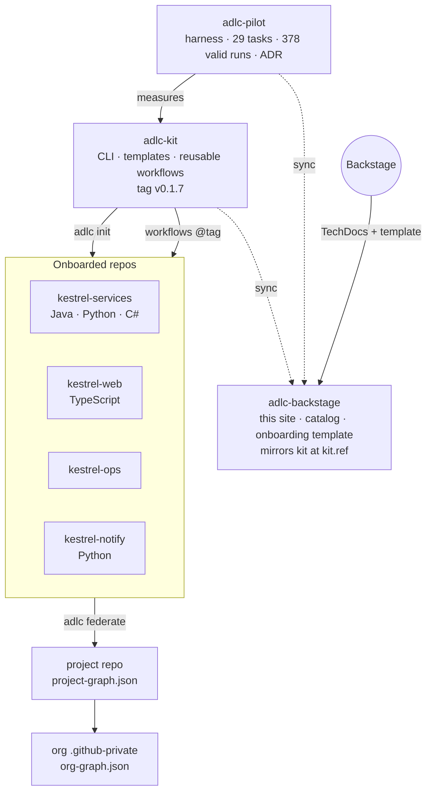

# ADLC

Make a repository agent-ready for GitHub Copilot CLI: a contract the agent reads, a context
layer CI keeps fresh, guardrails enforced in code, and a harness that measures whether any of
it helps. One CLI, `adlc`, and nothing outside the repo.

| this site describes | pinned at |
|---|---|
| kit `hpreowned/adlc-kit` | <!-- adlc:kit-ref -->`v0.1.7`<!-- /adlc:kit-ref --> |
| pilot evidence `hpreowned/adlc-pilot` | <!-- adlc:pilot-ref -->`c947356`<!-- /adlc:pilot-ref --> |

Pages marked *Mirrored* are copied from those sources at those refs by `make sync`; CI fails
if they drift. Edit them at the source.

## How the pieces relate

## Pick your path

| you are | start here | time |
|---|---|---|
| an engineer onboarding a repo | [Onboard a repo](adopt/index.md) or [from Backstage](adopt/from-backstage.md) | 15 min |
| anyone asking "what does this change about my day" | [The PR loop](how-it-works/pr-loop.md), [Where knowledge lives](how-it-works/knowledge-map.md) | 10 min |
| the platform team running it | [Reusable workflows](operate/workflows.md), [Pins and upgrades](operate/pins-and-upgrades.md), [Runbook](operate/runbook.md) | as needed |
| a lead deciding whether to roll it out | [Verdict](decide/index.md), then the [ADR](decide/adr.md) | 20 min |

## The verdict in one line

Adopt the contract and the kit now; do not make Graphify or Serena the default context layer.
378 valid runs, 29 tasks, 7 arms. Details and the numbers behind them: [Decide](decide/index.md).
